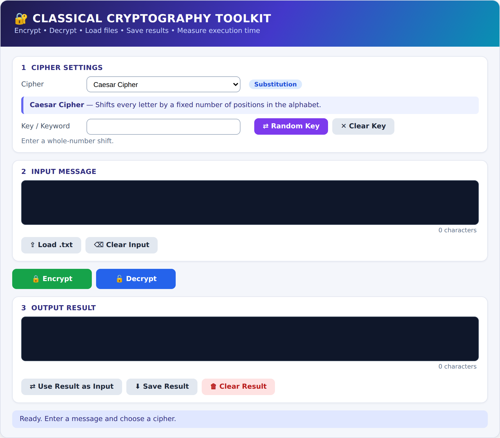

# Classical Cryptography Toolkit

A Python toolkit with an interactive GUI (Google Colab / Jupyter, built with `ipywidgets`) that encrypts and decrypts text using eight classical ciphers.
Mini Project for **Network Security**, Final Year ECM 2026-27, Walchand Institute of Technology, Solapur.



## Ciphers
| Substitution | Transposition |
|---|---|
| Caesar, Monoalphabetic, Playfair, Hill (2x2), Vigenere, One-Time Pad | Rail Fence, Columnar Transposition |

## Features
- Cipher drop-down with description and key hints
- Load a `.txt` file as input and save the result to `encrypted_result.txt`
- Execution time shown for every operation
- Random substitution-key generator and auto-generated One-Time Pad key
- Error handling for invalid keys and empty input

## Files
| File | Purpose |
|---|---|
| `crypto_toolkit_colab.py` | Complete toolkit with GUI (self-contained, paste into one Colab cell) |
| `crypto_core.py` | Cipher functions only (no GUI) |
| `test_toolkit.py` | Round-trip test of all ciphers |
| `compare_algorithms.py` | Execution-time comparison |

## Run in Google Colab
1. Open [colab.research.google.com](https://colab.research.google.com) and create a new notebook.
2. Paste the contents of `crypto_toolkit_colab.py` into a cell and run it.

## Run the tests locally
```bash
python test_toolkit.py
python compare_algorithms.py
```

## Example
`NETWORK SECURITY` with Caesar key `5` gives `SJYBTWP XJHZWNYD`.

## Author
Name: _add your name_  |  Roll No.: _add roll no._
